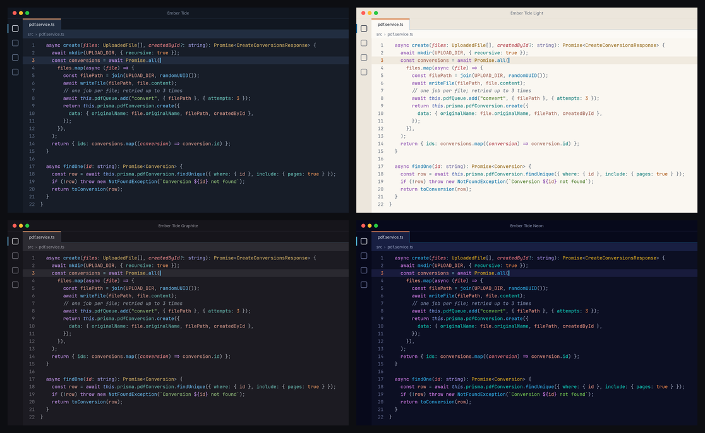
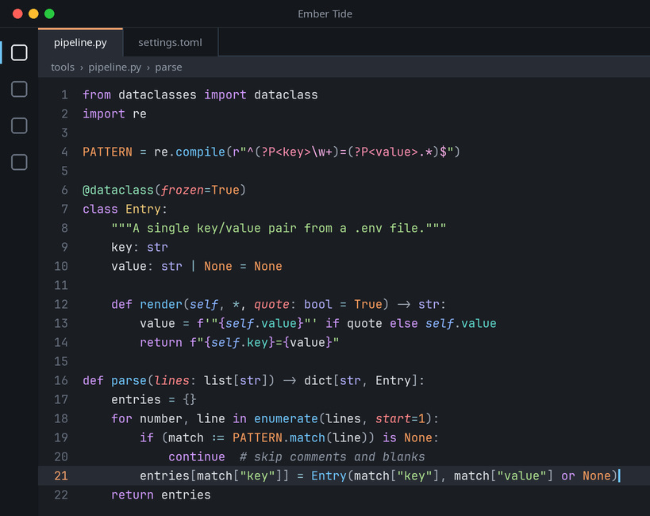

# Ember Tide

Warm–cool color themes for **VS Code**, **Zed** and **your terminal**: ember coral and amber for the things you write,
tide blue and teal for the things you call. Every theme is generated from a palette, so VS Code and Zed look the same.



## Themes

| Theme | Background | For |
|---|---|---|
| **Ember Tide** | night blue | the original; everyday dark theme |
| **Ember Tide Light** | warm paper | bright rooms and daylight |
| **Ember Tide Graphite** | neutral gray, like a browser's dark mode | switching between the editor and docs without your eyes readjusting; softer colors |
| **Ember Tide Neon** | deep indigo | more vivid colors at night |

Each theme also comes as a **No Italic** version (comments, parameters and `this` upright) for fonts without a good italic.




## Highlights

- **Even brightness** — code colors sit in one brightness band (APCA), so nothing glares when the screen is bright and nothing
  sinks when it is dimmed.
- **Readable first** — in the dark themes every syntax color reaches at least 7:1 contrast on the editor background (comments ≥ 4.5:1,
  even on the highlighted line); in Light every color, comments included, is above 5:1 on the paper background,
  and primary UI text passes WCAG AA.
- **Consistent roles** across languages — checked against 35+ grammars: TypeScript/TSX, JavaScript, Python, Go, Rust,
  C/C++, C#, Java, PHP, Ruby, Lua, Swift, Dart, R, Shell, PowerShell, SQL, HTML, CSS/SCSS, Markdown, JSON, YAML, TOML,
  INI, `.env`, Dockerfile, Makefile, Prisma, Protobuf and more.
- **Semantic highlighting** tuned to match the TextMate colors, so nothing jumps when the language server loads.
- **Subtle UI** — an ember line marks the active tab, quiet tide-blue borders everywhere else.

## Palette

Same role → same hue in every theme; brightness is tuned per background so code stays even at any screen brightness.

| Role | Ember Tide | Light | Graphite | Neon | |
|---|---|---|---|---|---|
| Background | `#171D28` | `#FAF7F1` | `#1C1B22` | `#0C0F23` | |
| Keyword | `#D29BFF` | `#803DA8` | `#D09DFA` | `#E387FF` | violet |
| Function / method | `#70C7FF` | `#0068A2` | `#70C7FF` | `#33BDFE` | sky blue |
| Property / field | `#72D4C9` | `#00716F` | `#6BC0B6` | `#0FDAC8` | teal |
| Type / class | `#E6C16D` | `#8A5A00` | `#E0BC6A` | `#F2BC20` | gold |
| Built-in type (`string`, `int`…) | `#B3B1FF` | `#666098` | `#ACABF5` | `#B69EFF` | lavender |
| Namespace / module | `#B9BD69` | `#615729` | `#C2C46E` | `#C2AA3C` | olive |
| Number / constant / boolean | `#FF9F5E` | `#A54A00` | `#F39D64` | `#FF904C` | orange |
| Decorator / attribute | `#84D6AB` | `#117449` | `#82CBA4` | `#2DDC96` | mint |
| String | `#A0D383` | `#3D6F16` | `#9AC880` | `#80D857` | green |
| Variable | `#ECA898` | `#975646` | `#E0A394` | `#FFA18D` | coral |
| Parameter *(italic)* | `#FF8B8D` | `#A82A34` | `#FF9295` | `#FF8088` | coral red |
| `this` / `self` *(italic)* | `#8AB3FF` | `#3952A7` | `#8AB3FF` | `#88ABFE` | periwinkle |
| Comment *(italic)* | `#8B99B1` | `#616B77` | `#939BA5` | `#8896B9` | slate |

## Install

### VS Code (and VSCodium, Cursor, Windsurf…)

Search **“Ember Tide”** in the Extensions view, then pick one of the eight themes with
<kbd>Ctrl</kbd>/<kbd>Cmd</kbd>+<kbd>K</kbd> <kbd>Ctrl</kbd>/<kbd>Cmd</kbd>+<kbd>T</kbd>.

### Zed

Open the command palette → `zed: extensions` → search **“Ember Tide”** → Install, then select it with `theme selector: toggle`.

#### Optional: matching semantic colors in Zed

Zed applies language-server colors through settings rather than themes. To get the same semantic colors as in VS Code,
add the rules from [`extras/zed-semantic-token-rules.json`](extras/zed-semantic-token-rules.json) to your `settings.json`:

```jsonc
{
  "semantic_tokens": "combined",
  "global_lsp_settings": {
    "semantic_token_rules": [ /* paste the rules here */ ]
  }
}
```

### Terminal

Matching palettes for Ptyxis, GNOME Terminal, Konsole, Windows Terminal, iTerm2, Ghostty, Kitty, Alacritty and WezTerm
live in [`terminals/`](terminals/) — see [`terminals/README.md`](terminals/README.md) for per-terminal install steps.

## Recommended settings

The screenshots use [JetBrains Mono](https://www.jetbrains.com/lp/mono/) at 15px with a 1.55 line height:

```jsonc
// VS Code
"editor.fontFamily": "'JetBrains Mono', monospace",
"editor.fontSize": 15,
"editor.lineHeight": 1.55,
"editor.fontLigatures": true,
"editor.semanticHighlighting.enabled": true
```

## Build from source

Requires Node.js 18+. Works on Linux, macOS and Windows.

```sh
npm run build           # generate themes/ (VS Code), zed/ (Zed) and terminals/ from palettes/*.mjs
npm test                # palette checks, generated-file checks, pinned published colors
npm run install:vscode  # package the .vsix and install it into VS Code / VSCodium / Cursor / Windsurf
npm run build:zed       # copy the theme into Zed's themes folder
npm run install:all     # VS Code + Zed + Ptyxis palette (Linux)
```

Colors live in [`palettes/dark.mjs`](palettes/dark.mjs); the editor-specific mappings are in [`src/`](src).
`node scripts/palette-report.mjs dark --all` prints every quality check.

## License

[MIT](LICENSE)
