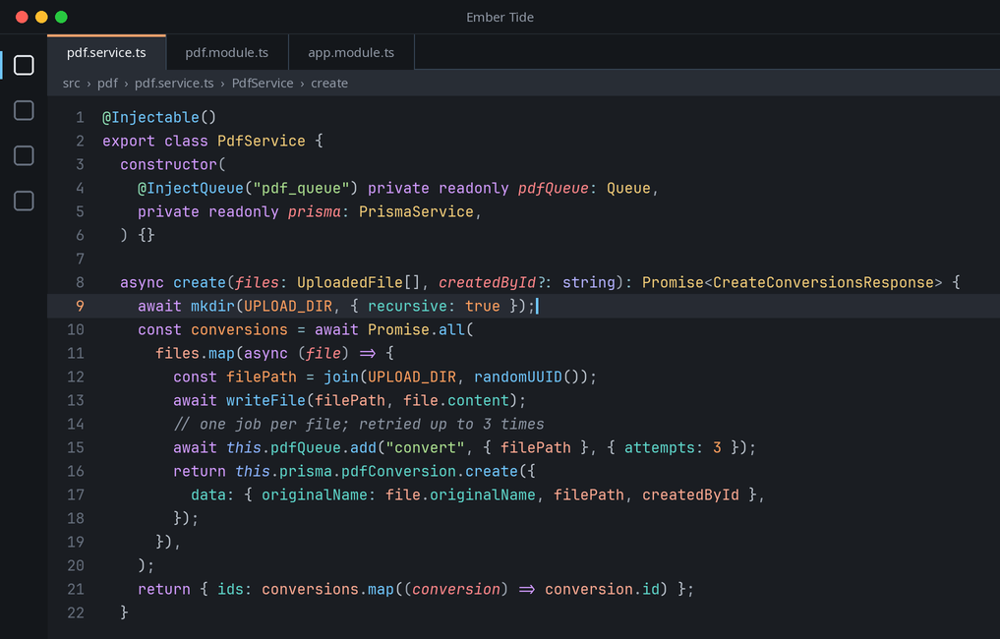

# Ember Tide

A warm–cool dark theme for **VS Code**, **Zed** and **your terminal**: a deep night canvas, ember coral and amber for the things you
write, tide blue and teal for the things you call. Both editors are generated from a single palette, so they look the same.




## Highlights

- **Readable first** — every syntax color reaches at least **7:1** contrast on the editor background (≥ 7.2:1) and
  ≥ 5.9:1 on the highlighted line; comments stay ≥ 4.5:1 on both.
- **Distinct roles** — no two syntax roles are closer than ΔE2000 10, so keywords, types, parameters and values never blur together.
- **Colorblind-checked** — simulated for deuteranopia and protanopia (Machado 2009, full severity): the roles that sit
  side by side (property, type, variable, namespace…) stay ≥ ΔE2000 6 apart (tritanopia ≥ 3). Known exception: with
  red–green deficiency, function blue sits close to keyword violet and built-in-type lavender — kept to preserve the
  vivid sky blue. Parameters and `this`/`self` also differ by italics.
- **Consistent across 35+ languages** — TypeScript/TSX, JavaScript, Python, Go, Rust, C/C++, C#, Java, PHP, Ruby, Lua, Swift, Dart,
  R, Shell, PowerShell, SQL, HTML, CSS/SCSS, Markdown, JSON, YAML, TOML, INI, `.env`, Dockerfile, Makefile, Prisma, Protobuf and more.
- **Semantic highlighting** matched to the TextMate colors, so nothing jumps when the language server loads.
- **Calm UI, clear states** — an ember line marks the active tab; selection, search matches, symbol occurrences and hover each get their own hue.
- **Tested** — `npm test` runs 160+ contrast, separation and color-blindness checks (palette plus the built theme, with translucent colors
  blended onto their real backgrounds), checks the generated files, and pins the published colors.

## Palette

| Role | Color | |
|---|---|---|
| Keyword | `#D29BFF` | violet |
| Function / method | `#70C7FF` | sky blue |
| Property / field | `#5ED7CB` | teal |
| Type / class | `#F2CC78` | gold |
| Built-in type (`string`, `int`…) | `#B3B1FF` | lavender |
| Namespace / module | `#BDAA67` | olive gold |
| Number / constant / boolean | `#FF9F5E` | orange |
| Decorator / attribute | `#8EE0B5` | mint |
| String | `#ACE08F` | green |
| Variable | `#FFAA92` | coral |
| Parameter *(italic)* | `#FF8689` | coral red |
| `this` / `self` *(italic)* | `#8AB3FF` | periwinkle |
| Comment *(italic)* | `#8B94A2` | slate |

## Install

### VS Code (and VSCodium, Cursor, Windsurf…)

Search **“Ember Tide”** in the Extensions view, then pick it with
<kbd>Ctrl</kbd>/<kbd>Cmd</kbd>+<kbd>K</kbd> <kbd>Ctrl</kbd>/<kbd>Cmd</kbd>+<kbd>T</kbd>.

### Zed

Open the command palette → `zed: extensions` → search **“Ember Tide”** → Install, then select it with `theme selector: toggle`.

#### Optional: semantic token rules for Zed

Zed already maps language-server tokens to theme styles. Three extra rules match VS Code more closely: TypeScript
parameter properties (`constructor(private readonly db: Db)`) use the property color, matching `this.db`; Rust built-in
types (`i32`, `str`) use the built-in type color; and Rust format specifiers (`{}`, `{:?}`) use the escape color. They
reference theme *styles* rather than hex colors — add them to your `settings.json`
(also in [`extras/zed-semantic-token-rules.json`](extras/zed-semantic-token-rules.json)):

```jsonc
{
  "semantic_tokens": "combined",
  "global_lsp_settings": {
    "semantic_token_rules": [
      { "token_type": "parameter", "token_modifiers": ["readonly"], "style": ["property"] },
      { "token_type": "builtinType", "style": ["type.builtin"] },
      { "token_type": "formatSpecifier", "style": ["string.escape"] }
    ]
  }
}
```

> **Upgrading from 1.0.0?** The old rules hard-coded hex colors. Replace them with the rules above — Zed's built-in
> rules already take decorator, namespace, parameter… colors from the theme.

### Terminal

Matching palettes for Ptyxis, GNOME Terminal, Konsole, Windows Terminal, iTerm2, Ghostty, Kitty, Alacritty and WezTerm
live in [`terminals/`](terminals/) — see [`terminals/README.md`](terminals/README.md) for per-terminal install steps.

## Recommended settings

The screenshots use [JetBrains Mono](https://www.jetbrains.com/lp/mono/) at 15px with a 1.55 line height:

```jsonc
// VS Code
"editor.fontFamily": "'JetBrains Mono', monospace",
"editor.fontSize": 15,
"editor.lineHeight": 1.55,
"editor.fontLigatures": true,
"editor.semanticHighlighting.enabled": true
```

## Build from source

Requires Node.js 18+. Works on Linux, macOS and Windows.

```sh
npm run build           # generate themes/ (VS Code), zed/ (Zed) and terminals/ from palettes/*.mjs
npm test                # contrast/separation rules on every built variant, output checks
npm run install:vscode  # package the .vsix and install it into VS Code / VSCodium / Cursor / Windsurf
npm run build:zed       # copy the theme into Zed's themes folder
npm run install:all     # VS Code + Zed + Ptyxis palette (Linux)
```

Colors live in [`palettes/dark.mjs`](palettes/dark.mjs); the editor-specific mappings are in [`src/`](src).
`node scripts/palette-report.mjs dark --all` prints every quality check.

## License

[MIT](LICENSE)
