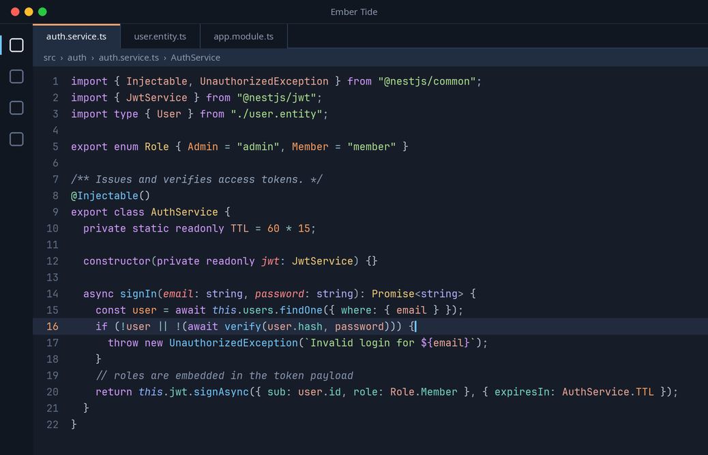
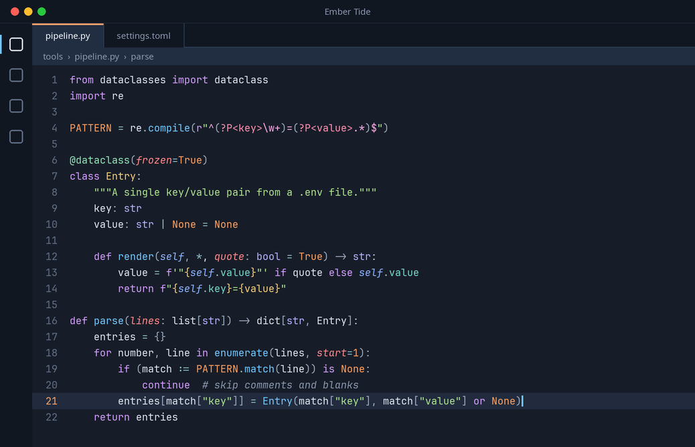

# Ember Tide

A warm–cool dark theme for **VS Code**, **Zed** and **your terminal**: a night-blue canvas, ember coral and amber for the things you
write, tide blue and teal for the things you call. Both editors are generated from a single palette, so they look the same.




## Highlights

- **Readable first** — every syntax color reaches at least 7:1 contrast on the editor background (comments ≥ 4.5:1, even on the highlighted line),
  and primary UI text passes WCAG AA.
- **Consistent roles** across languages — checked against 35+ grammars: TypeScript/TSX, JavaScript, Python, Go, Rust,
  C/C++, C#, Java, PHP, Ruby, Lua, Swift, Dart, R, Shell, PowerShell, SQL, HTML, CSS/SCSS, Markdown, JSON, YAML, TOML,
  INI, `.env`, Dockerfile, Makefile, Prisma, Protobuf and more.
- **Semantic highlighting** tuned to match the TextMate colors, so nothing jumps when the language server loads.
- **Subtle UI** — an ember line marks the active tab, quiet tide-blue borders everywhere else.

## Palette

| Role | Color | |
|---|---|---|
| Keyword | `#D29BFF` | violet |
| Function / method | `#70C7FF` | sky blue |
| Property / field | `#72D4C9` | teal |
| Type / class | `#F2CC78` | gold |
| Built-in type (`string`, `int`…) | `#B3B1FF` | lavender |
| Namespace / module | `#BDAA67` | olive gold |
| Number / constant / boolean | `#FF9F5E` | orange |
| Decorator / attribute | `#8EE0B5` | mint |
| String | `#ACE08F` | green |
| Variable | `#EDA898` | coral |
| Parameter | `#FF8689` *italic* | coral red |
| `this` / `self` | `#8AB3FF` *italic* | periwinkle |
| Comment | `#8694AC` *italic* | slate |

## Install

### VS Code (and VSCodium, Cursor, Windsurf…)

Search **“Ember Tide”** in the Extensions view, then pick it with
<kbd>Ctrl</kbd>/<kbd>Cmd</kbd>+<kbd>K</kbd> <kbd>Ctrl</kbd>/<kbd>Cmd</kbd>+<kbd>T</kbd>.

### Zed

Open the command palette → `zed: extensions` → search **“Ember Tide”** → Install, then select it with `theme selector: toggle`.

#### Optional: matching semantic colors in Zed

Zed applies language-server colors through settings rather than themes. To get the same semantic colors as in VS Code,
add the rules from [`zed/semantic_token_rules.json`](zed/semantic_token_rules.json) to your `settings.json`:

```jsonc
{
  "semantic_tokens": "combined",
  "global_lsp_settings": {
    "semantic_token_rules": [ /* paste the rules here */ ]
  }
}
```

### Terminal

Matching palettes for Ptyxis, GNOME Terminal, Konsole, Windows Terminal, iTerm2, Ghostty, Kitty, Alacritty and WezTerm
live in [`terminals/`](terminals/) — see [`terminals/README.md`](terminals/README.md) for per-terminal install steps.

## Recommended settings

The screenshots use [JetBrains Mono](https://www.jetbrains.com/lp/mono/) at 15px with a 1.55 line height:

```jsonc
// VS Code
"editor.fontFamily": "'JetBrains Mono', monospace",
"editor.fontSize": 15,
"editor.lineHeight": 1.55,
"editor.fontLigatures": true,
"editor.semanticHighlighting.enabled": true
```

## Build from source

Requires Node.js 18+. Works on Linux, macOS and Windows.

```sh
npm run build           # generate themes/ (VS Code), zed/ (Zed) and terminals/ from palette.mjs
npm run install:vscode  # package the .vsix and install it into VS Code / VSCodium / Cursor / Windsurf
npm run build:zed       # copy the theme into Zed's themes folder
npm run install:all     # VS Code + Zed + Ptyxis palette (Linux)
```

All colors live in [`palette.mjs`](palette.mjs); the editor-specific mappings are in [`src/`](src).

## License

[MIT](LICENSE)
